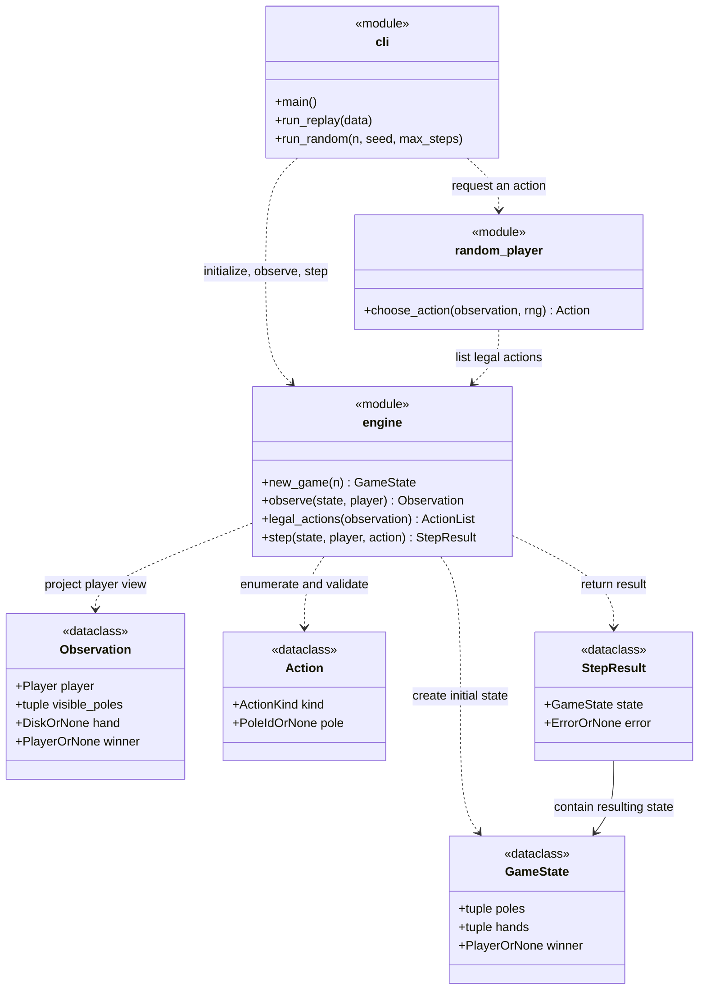
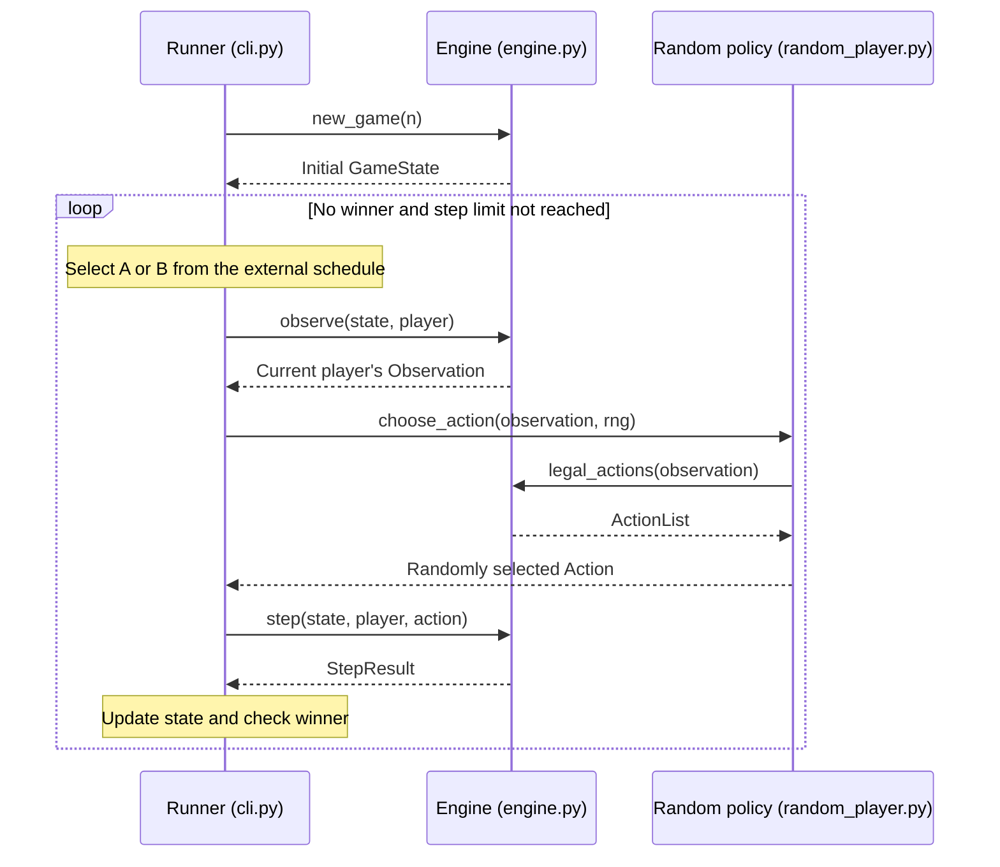

# Hanoi Crossing

An immutable data model and interface foundation for the Hanoi Crossing assignment.
This repository uses uv and the Python standard library.

**Current status:** the four data classes, constructor validation, public exports,
function signatures, and model/contract tests exist. Initialization, observation
projection, legal-move generation, transitions, random selection, replay, and CLI
execution are **not implemented**. Their functions raise `NotImplementedError`.
The behavior specified below is the implementation contract, not a claim that a
complete game can already run.

## Setup

Requires uv and Python 3.14 or newer. The development Python version is pinned to
3.14 in `.python-version`.

```sh
uv sync --locked
uv run --locked python -m unittest discover -s tests -v
```

The tests cover model validation, immutability, API signatures, explicit stub
failure, and example-file consistency. They do not establish gameplay correctness.

If this macOS environment reports `Skipping hidden .pth file` for its default
`.venv`, use a separate environment for both commands:

```sh
UV_PROJECT_ENVIRONMENT=/tmp/hanoi-crossing-env uv sync --locked
UV_PROJECT_ENVIRONMENT=/tmp/hanoi-crossing-env uv run --locked python -m unittest discover -s tests -v
```

This selects an environment outside the repository without changing the package
or global Python settings. The project configuration and imports have been
validated using an external environment. No CLI entry point is registered yet.

## Layout

```text
src/hanoi_crossing/
    __init__.py          # Public engine interface
    engine.py            # State, observations, legal actions, and transitions
    random_player.py     # Random player using the external-agent interface
    cli.py               # Replay and random-play frontends
tests/
    test_engine.py
    test_random_player.py
    test_cli.py
examples/
    replay.json          # N=1 contract input from the assignment example
    replay.expected.json # Hand-authored expected report, not engine output
```

All models, validation, rules, and adjudication belong in `engine.py`; `__init__.py`
exports its public interface. Both files count toward the core limit of **fewer
than 500 physical Python lines**, including comments and blank lines. Any future
module containing engine logic also counts. The CLI handles I/O, scheduling,
run limits, and reports. The random player receives only an observation and an
injected `random.Random` instance. There is no engine-owned RNG, scheduler, I/O,
HTTP service, or RL training implementation.

## Rules

Source: the supplied `HANOI_CROSSING-v1.1.md` assignment. The following includes the
owner's agreed interpretations of otherwise open behavior.

- `N` is a positive integer; booleans are not integers for this contract. A starts
  with odd disks `1, 3, ..., 2N-1` and B with even disks `2, 4, ..., 2N`, on their
  own starting poles, largest at the bottom. All other poles and both hands start
  empty. A disk's number denotes its size, not permanent ownership.
- A sees `1a, 2, 3a`; B sees `1b, 2, 3b`. Visible stacks are fully visible. Neither
  player receives the other's private poles or hand. Either may lift the shared
  top disk. Every disk remains in exactly one stack or one hand.
- Each externally scheduled turn performs exactly one `lift`, `place`, or `skip`.
  Lift requires an empty hand and a visible nonempty pole. Place requires a held
  disk and a visible pole that is empty or has a strictly larger top disk. Skip
  is legal whenever play is ongoing, even with a held disk. Lift and place are
  separate turns; a disk may return to its source or go directly to the goal.
- External schedules may repeat the same player. An illegal game action leaves
  the state unchanged and consumes that scheduled turn. Turn counts and records
  belong to the runner, not `GameState`.
- A player wins iff their hand, their starting pole, and the shared pole are
  empty, and their goal pole is nonempty. Disk ownership, goal disk count, and
  the other player's hand do not participate. Check both players after each
  action and stop at the first winner. The other player loses.

The nonempty-goal interpretation and immediate stopping are explicit decisions.
An opponent's move can cause a win: if A has disk 3 on `3a`, disk 1 is shared, and
A's hand and start are empty, B lifting disk 1 makes A win. From a legal initial
state, one atomic action cannot first create two winners: clearing the last
shared disk fills the actor's hand, preventing that actor from winning too.

Terminal states are frozen. Repeated positions and repeated skips do not cause
a draw. Replay exhaustion and a random-run step limit stop the run without a
winner; they are not game-defined draws.

## Data model

All four classes are `@dataclass(frozen=True, slots=True)`. Stored collections
must be tuples, including each nested stack; mutable inputs are rejected rather
than retained or silently converted. Empty stacks are `()`, empty hands are
`None`, and **every stack runs bottom to top**, so its last item is the top disk.

| Model | Fields and fixed order |
| --- | --- |
| `GameState` | `poles`: five stacks in `POLE_IDS = ("1a", "1b", "2", "3a", "3b")`; `hands`: `(A, B)`; `winner`: `"A"`, `"B"`, or `None` |
| `Observation` | `player`; `visible_poles`: `(own start, shared, own goal)`; `hand`: this player's hand; `winner`: public terminal result |
| `Action` | `kind`: `"lift"`, `"place"`, or `"skip"`; `pole`: absolute pole ID for lift/place, `None` for skip; actor is a separate `step` argument |
| `StepResult` | `state`: `GameState`; `error`: a declared error code or `None`; `None` means accepted, including a legal skip |

For A, visible stacks correspond to global indices `(0, 2, 3)`; for B, `(1, 2, 4)`.
The exported aliases include `Player`, `PoleId`, `ActionKind`, `Disk`, `Stack`,
`Poles`, `Hands`, `VisiblePoles`, `Error`, and `ActionList`. `ActionList` is an
immutable `tuple[Action, ...]`, not a mutable list. `OrNone` in the diagram is
shorthand for a Python `| None` annotation, not an additional model.

Constructors currently reject invalid shapes or labels, nonpositive/noninteger
disks (including booleans), nondecreasing stacks, and duplicates. A full state
must contain exactly the contiguous set `1..2N` for some positive `N`; an
observation contains only its visible subset. Invalid model values raise
`ValueError`; ordinary Python call-signature errors remain `TypeError`.

These checks establish structural validity, not reachability or adjudication.
A valid winner label is not yet checked against the board. Observations cannot
prove that they were faithfully projected, and `StepResult` has no previous
state with which to check a rejection. Those guarantees belong to the pending
engine functions; transition-time disk conservation must preserve the original
game's inventory, not merely some structurally valid `1..2N` set.



## Python API contract

The following functions are signatures only at present; all raise
`NotImplementedError` before performing gameplay or input parsing.

| Function | Required behavior once implemented |
| --- | --- |
| `new_game(n: int) -> GameState` | Reject nonpositive or noninteger `n`, including booleans, with `ValueError`; create the agreed initial state |
| `observe(state: GameState, player: Player) -> Observation` | Return the current player's three stacks, own hand, and public winner; reject an invalid player with `ValueError` |
| `legal_actions(observation: Observation) -> ActionList` | Use this observation alone; return `()` when terminal; otherwise return the canonical legal actions below |
| `step(state: GameState, player: Player, action: Action) -> StepResult` | Validate the actor and action against the actual state; perform one atomic action, check both players, and never mutate the input |
| `choose_action(observation: Observation, rng: random.Random) -> Action` | Call `legal_actions` and uniformly choose from it; raise `ValueError` if no actions are available |
| `run_replay(data: dict[str, object]) -> dict[str, object]` | Validate the entire input before running; execute its explicit schedule and return the report below |
| `run_random(n: int, seed: int, max_steps: int) -> dict[str, object]` | Validate parameters; use one local seeded RNG and fresh observations for alternating A/B turns; return the report below |
| `main() -> int` | Parse CLI input, report input failures, and serialize one run report; return the process exit status |

Canonical action order is `skip` first, followed by all legal lifts when the hand
is empty, or all legal places when it is occupied. Candidate poles are always
examined in `(own start, shared, own goal)` order. This fixes the sampling order
for seed reproducibility. No hidden state is needed to enumerate these actions.

`step` does not trust an agent's claim that its action is legal. A rejected action
returns the **same input state object** with a nonempty error code. Terminal
calls do the same with `game_over`. An accepted skip also returns the same state
object, with no error. Changed states are new immutable values.

### Input errors versus illegal game actions

Unknown players, unknown action kinds or pole IDs, missing required fields,
wrong types, and a `skip` with a non-null pole are input errors. Python model
constructors and the eventual runner validators use `ValueError` for invalid
values. They are not counted as game turns. Missing Python arguments or
unexpected Python keyword arguments are ordinary `TypeError`s.

A known pole belonging to the other player is a well-shaped action but is
illegal for this actor. It consumes a replay turn just like lifting from an
empty visible pole. For well-shaped `step` calls, rejection precedence is:

1. `game_over`: a winner already exists.
2. `invisible_pole`: the target is not visible to the actor.
3. Lift: `hand_full`, then `empty_pole`.
4. Place: `empty_hand`, then `illegal_placement` for a nonempty target whose top
   is not strictly larger.

This order avoids inspecting or disclosing a hidden pole's contents. Skip has
no target or hand precondition during ongoing play. Input validation precedes
these rule checks, including for terminal calls.

### Observation delivery and random play

The runner holds the complete referee state. On **each** turn it selects the
actor externally, calls `observe`, and passes that `Observation` to the same
`choose_action` function used for either player. The strategy receives no
`GameState`. Obtaining an observation and applying its selected action must not
be interleaved with another action in that same game. A future service must
serialize those operations per game outside this engine; different game states
and RNG instances remain independent.



## Input and output

Replay accepts a UTF-8 JSON file containing the recorded moves and turn order.
Random play accepts command-line parameters. Both frontends return the same
JSON run-report structure, with an additional seed field for random play.

These commands are planned interfaces and **are not runnable yet**:

```sh
uv run hanoi-crossing replay examples/replay.json
uv run hanoi-crossing random --n 3 --seed 42 --max-steps 1000
```

### Input: replay file

Input is a UTF-8 JSON object with exactly `n` and `turns`. `n` is a positive
integer, excluding booleans. `turns` is an array, possibly empty. Each turn has
exactly `player` and `action`, and each action has exactly `kind` and `pole`.
For skip, explicitly write `"pole": null`. Players and action fields use the
case-sensitive identifiers above. Unknown/missing keys, duplicate JSON keys,
and nonstandard JSON numbers are input errors. Validate the whole document,
including any eventual unexecuted tail, before initializing a run.

The ordered turns combine the pre-recorded moves and their external schedule;
there are no separate arrays whose lengths could disagree. For example:

```json
{
  "n": 1,
  "turns": [
    {"player": "A", "action": {"kind": "lift", "pole": "1a"}},
    {"player": "B", "action": {"kind": "lift", "pole": "1b"}},
    {"player": "A", "action": {"kind": "place", "pole": "3a"}}
  ]
}
```

### Input: random-play parameters

All three CLI options `--n`, `--seed`, and `--max-steps` are required. `n` and
`max_steps` are positive integers; `seed` is any integer. Python callers must not
pass booleans in place of these integers. Each run creates `random.Random(seed)`
once and shares it between A's and B's choices in that run. A acts first and
players alternate; this policy is in the runner, not the engine. Both players
uniformly sample all their current legal actions, including skip. Reproducibility
is defined for the same Python and engine versions, parameters, and canonical
action order. No cross-version random-sequence guarantee is made.

### Output: run report

Both runners return a JSON-compatible dictionary. JSON object key order and
whitespace are not part of the protocol; stack and turn array order are.

| Field | Meaning |
| --- | --- |
| `state` | Full referee snapshot: `poles` keyed by all five absolute pole IDs, `hands` keyed by `A` and `B`, and `winner`; tuples serialize as arrays and `None` as JSON `null` |
| `steps_consumed` | Number of attempted in-game turns, including illegal actions and skips; equals `len(steps)` |
| `stop_reason` | `"winner"`, `"sequence_exhausted"` for replay, or `"max_steps"` for random play |
| `steps` | Consumed turns in order; each has `player`, the submitted `action`, and `error` (`null` when accepted, otherwise a declared step error) |
| `unexecuted_turns` | Exact unconsumed replay tail, in order; `[]` for random runs, which do not pre-generate future actions |
| `seed` | Present only for random runs; the integer seed supplied to that run |

The full report is for the caller/referee, never input to the random strategy.
On a win, stop before consuming the next turn. `winner` takes precedence if the
last available turn or allowed step also wins. Otherwise exhaustion or the step
limit leaves `state.winner` as `null`. An empty replay returns the initial state,
zero consumed steps, and `sequence_exhausted`.

`examples/replay.expected.json` is the hand-authored report for the input above:
A wins with disk 1 on `3a`, while B still holds disk 2. It is a contract fixture,
not output captured from an implemented engine. Tests currently validate its
shape and consistency; a future integration test must compare actual replay
output with it.

```json
{
  "state": {
    "poles": {"1a": [], "1b": [], "2": [], "3a": [1], "3b": []},
    "hands": {"A": null, "B": 2},
    "winner": "A"
  },
  "steps_consumed": 3,
  "stop_reason": "winner",
  "steps": [
    {"player": "A", "action": {"kind": "lift", "pole": "1a"}, "error": null},
    {"player": "B", "action": {"kind": "lift", "pole": "1b"}, "error": null},
    {"player": "A", "action": {"kind": "place", "pole": "3a"}, "error": null}
  ],
  "unexecuted_turns": []
}
```

### Process output and exit status

Successful execution emits exactly one JSON report to stdout and exits 0,
including runs with no winner. Invalid input or an unreadable replay file emits
a diagnostic to stderr, no report to stdout, and exits 2. Internal failures must
remain failures; they must never be converted into an apparently successful game
report. The current stubs propagate `NotImplementedError` rather than returning
invented reports.

## AI assistance

OpenAI Codex scaffolded this project based on the class diagram provided by
Xiaokang Yin. It created the package structure, immutable data models and
validation, public exports, and function stubs following that diagram.
Codex also assisted with rule discussions, input/output documentation, model and
contract tests, example fixtures, and repository guidance in `AGENTS.md`.
A Codex subagent reviewed the rules, model boundaries, and contract consistency.
Full gameplay and frontend behavior are still pending; model/contract checks are
not represented as full game acceptance tests.
