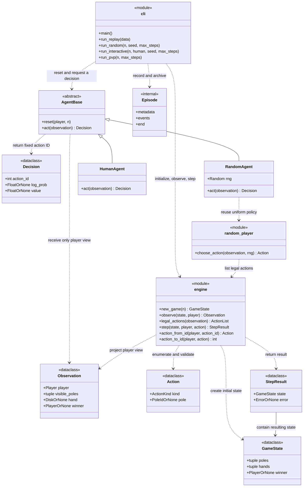

# Hanoi Crossing

An immutable, reusable game engine for the Hanoi Crossing assignment.
This repository uses uv and the Python standard library.

**Current status:** the core engine implements initialization, player observations,
legal-action enumeration, atomic transitions, input validation, and adjudication.
Fixed player-relative action IDs, bidirectional conversions, replay, uniform
random play, human-versus-random play, local hot-seat PvP, observation-only
agents, and automatic Episode archives are implemented. Tests exercise the
engine directly, batch runners, interaction, archives, and registered CLI.

## Setup

Requires uv and Python 3.14 or newer. The development Python version is pinned to
3.14 in `.python-version`.

```sh
uv sync --locked
uv run --locked python -m unittest discover -s tests -v
```

The tests cover model validation, immutability, engine rules and errors, fixed
action IDs, reachable N=1 states, core line count, API signatures, random/replay
equivalence, input errors, and process behavior. Both the real replay runner and
registered CLI must match the hand-authored expected report.

The `uv` executable must be on the terminal's `PATH`. In this development setup
it is installed in `~/.local/bin`, which both login and interactive zsh sessions
include. No temporary uv executable or environment-variable prefix is needed.

This macOS checkout previously marked the editable-install `.pth` file inside
the default `.venv` as hidden, so Python skipped it. The local `.venv` now points
to a persistent environment outside the repository. To create the same layout
when `.venv` does not already exist:

```sh
uv venv --python 3.14 "$HOME/.local/share/uv/venvs/hanoi-crossing"
ln -s "$HOME/.local/share/uv/venvs/hanoi-crossing" .venv
uv sync --locked
```

The environment and symlink are ignored by Git. Ordinary `uv run` discovers this
environment; package imports and global Python settings are unchanged. Other
checkouts can use the usual project-local `.venv` created by `uv sync`.

## Layout

```text
src/hanoi_crossing/
    __init__.py          # Public engine interface
    engine.py            # State, observations, legal actions, and transitions
    agents.py            # AgentBase and immutable Decision (counts toward core)
    random_player.py     # Uniform random policy and RandomAgent adapter
    cli.py               # Frontends, shared scheduling, Episode records and I/O
tests/
    test_engine.py
    test_gameplay.py
    test_action_ids.py
    test_core_size.py
    test_random_player.py
    test_cli.py
    test_cli_process.py
    test_interactive.py
    test_agents.py
    test_episodes.py
    test_pvp.py
examples/
    replay.json          # N=1 contract input from the assignment example
    replay.expected.json # Hand-authored expected report checked against the CLI
runs/                    # Per-game referee archives; ignored by Git
docs/
    DATASET_GUIDE.md      # Data collection and future training interpretation
```

Game models, validation, rules, and adjudication belong in `engine.py`;
`__init__.py` exports its public interface. These files and `agents.py` count
toward the core limit of **fewer than 500 physical Python lines**, including
comments and blank lines. Any future module containing engine logic also counts.
The CLI handles I/O, scheduling, run limits, reports, and Episode records.
The random player receives only an observation and an
injected `random.Random` instance. There is no engine-owned RNG, scheduler, I/O,
HTTP service, or RL training implementation.

`test_core_size.py` automatically counts all package Python files except the two
frontend modules (`cli.py` and `random_player.py`). This includes future core
helpers. It fails at 500 lines; moving rules into a frontend is not allowed.

## Rules

Source: the supplied `HANOI_CROSSING-v1.1.md` assignment. The following includes the
owner's agreed interpretations of otherwise open behavior.

- `N` is a positive integer; booleans are not integers for this contract. A starts
  with odd disks `1, 3, ..., 2N-1` and B with even disks `2, 4, ..., 2N`, on their
  own starting poles, largest at the bottom. All other poles and both hands start
  empty. A disk's number denotes its size, not permanent ownership.
- A sees `1a, 2, 3a`; B sees `1b, 2, 3b`. Visible stacks are fully visible. Neither
  player receives the other's private poles or hand. Either may lift the shared
  top disk. Every disk remains in exactly one stack or one hand.
- Each externally scheduled turn performs exactly one `lift`, `place`, or `skip`.
  Lift requires an empty hand and a visible nonempty pole. Place requires a held
  disk and a visible pole that is empty or has a strictly larger top disk. Skip
  is legal whenever play is ongoing, even with a held disk. Lift and place are
  separate turns; a disk may return to its source or go directly to the goal.
- External schedules may repeat the same player. An illegal game action leaves
  the state unchanged and consumes that scheduled turn. Turn counts and records
  belong to the runner, not `GameState`.
- A player wins iff their hand, their starting pole, and the shared pole are
  empty, and their goal pole is nonempty. Disk ownership, goal disk count, and
  the other player's hand do not participate. Check both players after each
  action and stop at the first winner. The other player loses.

The nonempty-goal interpretation and immediate stopping are explicit decisions.
An opponent's move can cause a win: if A has disk 3 on `3a`, disk 1 is shared, and
A's hand and start are empty, B lifting disk 1 makes A win. From a legal initial
state, one atomic action cannot first create two winners: clearing the last
shared disk fills the actor's hand, preventing that actor from winning too.

Terminal states are frozen. Repeated positions and repeated skips do not cause
a draw. Replay exhaustion and a random-run step limit stop the run without a
winner; they are not game-defined draws.

In a reachable nonterminal state, at least one player has a non-skip action.
Initially a starting disk can be lifted; afterward, the most recent successful
non-skip action can be reversed by the same player. Later skips and rejected
actions preserve that option. This is a rule-level argument, not a guarantee
that a runner will finish: an unfair schedule, repeated actions, or poor
strategies can prevent progress indefinitely.

## Data model

All four engine classes are `@dataclass(frozen=True, slots=True)`. Stored collections
must be tuples, including each nested stack; mutable inputs are rejected rather
than retained or silently converted. Empty stacks are `()`, empty hands are
`None`, and **every stack runs bottom to top**, so its last item is the top disk.

| Model           | Fields and fixed order                                                                                                                                |
| --------------- | ----------------------------------------------------------------------------------------------------------------------------------------------------- |
| `GameState`   | `poles`: five stacks in `POLE_IDS = ("1a", "1b", "2", "3a", "3b")`; `hands`: `(A, B)`; `winner`: `"A"`, `"B"`, or `None`              |
| `Observation` | `player`; `visible_poles`: `(own start, shared, own goal)`; `hand`: this player's hand; `winner`: public terminal result                    |
| `Action`      | `kind`: `"lift"`, `"place"`, or `"skip"`; `pole`: absolute pole ID for lift/place, `None` for skip; actor is a separate `step` argument |
| `StepResult`  | `state`: `GameState`; `error`: a declared error code or `None`; `None` means accepted, including a legal skip                               |

For A, visible stacks correspond to global indices `(0, 2, 3)`; for B, `(1, 2, 4)`.
The exported aliases include `Player`, `PoleId`, `ActionKind`, `Disk`, `Stack`,
`Poles`, `Hands`, `VisiblePoles`, `Error`, and `ActionList`. `ActionList` is an
immutable `tuple[Action, ...]`, not a mutable list. `OrNone` in the diagram is
shorthand for a Python `| None` annotation, not an additional model.

Constructors currently reject invalid shapes or labels, nonpositive/noninteger
disks (including booleans), nondecreasing stacks, and duplicates. A full state
must contain exactly the contiguous set `1..2N` for some positive `N`; an
observation contains only its visible subset. Invalid model values raise
`ValueError`; ordinary Python call-signature errors remain `TypeError`.

`GameState` construction is the single validation boundary for both structural
invariants and the cached winner. The supplied `winner` must exactly match the
board: `None` when neither player wins, or the sole winning player's label.
Missing or incorrect winner labels raise `ValueError`. A board satisfying both
players' win conditions also raises `ValueError`; the engine invents no tiebreak
for a state that cannot arise under immediate stopping. Full historical
reachability is not checked.

Engine functions require the declared model types and rely on these immutable
constructor invariants. `step` computes the new poles, hands, and winner before
constructing one complete `GameState`, so it exposes no unadjudicated intermediate
state. Successful transitions preserve the original inventory. Skips and rejected
actions retain the already validated input object. `observe` provides a faithful
projection; an independently constructed `Observation` can validate only its
visible subset. Likewise, `StepResult` alone cannot prove rejection identity
without a previous state, but `step` guarantees it.



## Python API contract

All functions below are implemented. `run_replay` and `run_random` do not print,
read files, or exit the process. They project the internally recorded Episode
into the original report. `run_interactive` and `run_pvp` perform terminal I/O
without archiving files; `main` shares their scheduling and owns file I/O.
Episode builders are internal APIs. Runner input errors raise
`InputError`, a `ValueError` subclass defined in `cli.py`.

| Function                                                                  | Contract                                                                                                                                                    |
| ------------------------------------------------------------------------- | ----------------------------------------------------------------------------------------------------------------------------------------------------------- |
| `new_game(n: int) -> GameState`                                         | Reject nonpositive or noninteger`n`, including booleans, with `ValueError`; create the agreed initial state                                             |
| `observe(state: GameState, player: Player) -> Observation`              | Return the current player's three stacks, own hand, and public winner; reject an invalid player with`ValueError`                                          |
| `legal_actions(observation: Observation) -> ActionList`                 | Use this observation alone; return`()` when terminal; otherwise return the canonical legal actions below                                                  |
| `step(state: GameState, player: Player, action: Action) -> StepResult`  | Validate the actor and action against the actual state; perform one atomic action, check both players, and never mutate the input                           |
| `action_from_id(player: Player, action_id: int) -> Action`              | Decode one fixed player-relative ID without consulting state or move legality; reject invalid players or IDs with`ValueError`                             |
| `action_to_id(player: Player, action: Action) -> int`                   | Encode a visible action without checking move legality; reject invalid players, non-`Action` inputs, or another player's private pole with `ValueError` |
| `choose_action(observation: Observation, rng: random.Random) -> Action` | Call`legal_actions` and uniformly choose from it; raise `ValueError` if no actions are available                                                        |
| `run_replay(data: dict[str, object]) -> dict[str, object]`              | Validate the entire input before running; execute its explicit schedule and return the report below                                                         |
| `run_random(n: int, seed: int, max_steps: int) -> dict[str, object]`    | Validate parameters; use one local seeded RNG and fresh observations for alternating A/B turns; return the report below                                     |
| `run_interactive(n: int, human: Player, seed: int, max_steps: int) -> int` | Validate parameters; alternate human and random turns; display only the human observation; return 0 on normal completion |
| `run_pvp(n: int, max_steps: int) -> int` | Alternate two local humans with handoff confirmation; no file I/O; return 0 on normal completion or 130 on interruption |
| `main() -> int` | Parse CLI input, report input failures, and serialize a batch report or start interactive play; return the process exit status |

The core can already execute the assignment's example directly:

```python
from hanoi_crossing import Action, new_game, step

state = new_game(1)
state = step(state, "A", Action("lift", "1a")).state
state = step(state, "B", Action("lift", "1b")).state
result = step(state, "A", Action("place", "3a"))
assert result.error is None and result.state.winner == "A"
```

Canonical action order is `skip` first, followed by all legal lifts when the hand
is empty, or all legal places when it is occupied. Candidate poles are always
examined in `(own start, shared, own goal)` order. This fixes the sampling order
for seed reproducibility. No hidden state is needed to enumerate these actions.

`step` does not trust an agent's claim that its action is legal. A rejected action
returns the **same input state object** with a nonempty error code. Terminal
calls do the same with `game_over`. An accepted skip also returns the same state
object, with no error. Changed states are new immutable values.

### Fixed action IDs

The public immutable tuple `ACTION_IDS = (0, 1, 2, 3, 4, 5, 6)` defines the
complete action space. IDs are fixed from the first version and share the same
player-relative meaning for A and B. They are **not indices into the current
`legal_actions` result**.

| ID | Meaning      | A's`Action(kind, pole)` | B's`Action(kind, pole)` |
| -- | ------------ | ------------------------- | ------------------------- |
| 0  | skip         | `Action("skip")`        | `Action("skip")`        |
| 1  | lift_start   | `Action("lift", "1a")`  | `Action("lift", "1b")`  |
| 2  | lift_shared  | `Action("lift", "2")`   | `Action("lift", "2")`   |
| 3  | lift_goal    | `Action("lift", "3a")`  | `Action("lift", "3b")`  |
| 4  | place_start  | `Action("place", "1a")` | `Action("place", "1b")` |
| 5  | place_shared | `Action("place", "2")`  | `Action("place", "2")`  |
| 6  | place_goal   | `Action("place", "3a")` | `Action("place", "3b")` |

`start/shared/goal` map to `1a/2/3a` for A and `1b/2/3b` for B. Conversions
depend only on the player and ID or action, never on the board, held disk,
number of legal actions, or terminal status. For either player, encoding a
decoded ID returns the same ID; decoding an encoded visible action returns
the same action.

For example, while holding a disk, ID 1 still decodes to `lift_start`; passing
it to `step` returns `hand_full`. Legal actions may then have IDs `(0, 4, 5, 6)`:
the second entry has ID 4, not ID 1. During ongoing play ID 0 is always legal;
terminal `legal_actions` returns `()`, although the conversions still work.
Episode records mark these seven IDs with a boolean action mask derived solely
from the acting player's observation and legal actions. No training framework
is implemented here.

Decoding rejects booleans, nonintegers, negative IDs, and IDs above 6 with
`ValueError`. Both conversions reject invalid players. Encoding another player's
private pole also raises `ValueError` because it has no ID in this relative
action space. Such an `Action` remains structurally valid and, when submitted
directly to `step` during ongoing play, still returns `invisible_pole`.

Replay JSON continues to use `kind/pole`; it does not accept an `action_id`
field or a second way to supply the same action.

### Input errors versus illegal game actions

Unknown players, unknown action kinds or pole IDs, missing required fields,
wrong types, and a `skip` with a non-null pole are input errors. Python model
constructors use `ValueError`; runner protocol validation uses `InputError` for
invalid values. They are not counted as game turns. Missing Python arguments or
unexpected Python keyword arguments are ordinary `TypeError`s.

A known pole belonging to the other player is a well-shaped action but is
illegal for this actor. It consumes a replay turn just like lifting from an
empty visible pole. For well-shaped `step` calls, rejection precedence is:

1. `game_over`: a winner already exists.
2. `invisible_pole`: the target is not visible to the actor.
3. Lift: `hand_full`, then `empty_pole`.
4. Place: `empty_hand`, then `illegal_placement` for a nonempty target whose top
   is not strictly larger.

This order avoids inspecting or disclosing a hidden pole's contents. Skip has
no target or hand precondition during ongoing play. Input validation precedes
these rule checks, including for terminal calls.

### Agent protocol and observation delivery

`AgentBase` and `Decision` are imported from `hanoi_crossing.agents`.
`reset(self, *, player: Player, n: int) -> None` sets public context and is called
once on each player's separate agent instance at the start of every game.
Stateful subclasses must call the base method and clear their own per-game
memory. `act(self, observation: Observation) -> Decision` receives only the
acting player's immutable observation, never `GameState`, an Episode, or an
opponent's view. The runner stops before another `act` once a winner exists.

`Decision` is a frozen, slotted dataclass with `action_id`, `log_prob=None`, and
`value=None`. IDs must be integers 0 through 6, excluding booleans. Optional
policy values must be finite numbers, not booleans; absent values stay null,
not invented zeros. These values describe the actual sampled action if supplied.

`RandomAgent` in `random_player.py` wraps `choose_action` and converts its action
to the fixed ID. A random game uses two agents and one shared `Random(seed)`;
reset never reseeds it. The sampling order and old seeded trajectories are
unchanged. `HumanAgent` in `cli.py` reads terminal decisions; quit and EOF are
control signals, not decisions. Human illegal actions are recorded attempts.
Any rejected automated-agent decision is an implementation error, never a retry.

Random, play, and PvP share one alternating scheduler. Replay keeps its explicit
actor order and raw actions, bypassing agents while reusing the same step and
record path. Observing and applying an action must not interleave with another
turn in the same game. Game state and per-game RNGs remain independent.

```mermaid
sequenceDiagram
    participant R as Runner (cli.py)
    participant E as Engine (engine.py)
    participant P as Acting Agent
    participant D as Episode

    R->>P: reset(player, n) once per player
    R->>E: new_game(n)
    E-->>R: Initial GameState

    loop No winner and step limit not reached
        Note over R: Select A or B from the external schedule
        opt Local PvP
            Note over R: Clear screen and confirm handoff before displaying view
        end
        R->>E: observe(state, player)
        E-->>R: Current player's Observation
        R->>P: act(observation)
        P-->>R: Decision with fixed action ID
        R->>E: action_from_id(player, action_id)
        E-->>R: Action

        R->>E: step(state, player, action)
        E-->>R: StepResult
        R->>D: Record pre-action view, mask, action and result
        Note over R,D: Commit state and event count together, then check winner
    end
    R->>D: Finalize termination, truncation, abort or agent failure
    Note over R,D: CLI alone publishes the archive; batch output keeps its old shape
```

## Input and output

Replay accepts a UTF-8 JSON file containing the recorded moves and turn order.
Random play accepts command-line parameters. These two batch frontends return
the same JSON run-report structure, with an additional seed field for random
play. Interactive `play` reads terminal actions and displays text from the
human player's observation. `pvp` alternates two local humans. Every successfully
started CLI game that ends normally or through quit/EOF/handled interruption
saves a referee Episode; Python calls do not automatically write files.

Run a frontend after setup:

```sh
uv run hanoi-crossing replay examples/replay.json
uv run hanoi-crossing play --n 3 --human A --seed 42 --max-steps 1000
uv run hanoi-crossing random --n 5 --seed 42 --max-steps 10000
uv run hanoi-crossing pvp --n 3 --max-steps 1000
```

### Input: replay file

Input is a UTF-8 JSON object with exactly `n` and `turns`. `n` is a positive
integer, excluding booleans. `turns` is an array, possibly empty. Each turn has
exactly `player` and `action`, and each action has exactly `kind` and `pole`.
For skip, explicitly write `"pole": null`. Players and action fields use the
case-sensitive identifiers above. Unknown/missing keys, duplicate JSON keys,
and nonstandard JSON numbers are input errors. Validate the whole document,
including any eventual unexecuted tail, before initializing a run. Errors identify
the affected object or field, such as `turns[7].action.pole`. The runner does not
mutate the supplied document.

The ordered turns combine the pre-recorded moves and their external schedule;
there are no separate arrays whose lengths could disagree. For example:

```json
{
  "n": 1,
  "turns": [
    {"player": "A", "action": {"kind": "lift", "pole": "1a"}},
    {"player": "B", "action": {"kind": "lift", "pole": "1b"}},
    {"player": "A", "action": {"kind": "place", "pole": "3a"}}
  ]
}
```

### Input: random-play parameters

All three CLI options `--n`, `--seed`, and `--max-steps` are required. `n` and
`max_steps` are positive integers; `seed` is any integer. Python callers must not
pass booleans in place of these integers. Each run creates `random.Random(seed)`
once and shares it between A's and B's choices in that run. A acts first and
players alternate; this policy is in the runner, not the engine. Both players
uniformly sample all their current legal actions, including skip. Reproducibility
is defined for the same Python and engine versions, parameters, and canonical
action order. No cross-version random-sequence guarantee is made.

The policy calls `rng.choice(legal_actions(observation))` after checking for an
empty terminal action set. It applies no weights, search, win preference,
repetition avoidance, or filtering of reversals and other unhelpful moves.
Each scheduled turn uses a fresh observation. If the policy ever submits an
action that `step` rejects, the runner raises `RuntimeError` without retrying:
that is an implementation defect, not an ordinary replay error.

A random report's consumed `player/action` records can be used as replay input
with the same `n`. Tests require identical final states and per-action results;
`max_steps` becomes `sequence_exhausted` when neither run has a winner.

### Input and output: interactive play

`play` requires `--n`, `--seed`, and `--max-steps` with the same integer
constraints as random play. `--human A` is the default; `--human B` makes the
computer act first. A always starts and players alternate. The computer uses
the same uniform random policy and a per-game `Random(seed)` instance.

The terminal shows only the human's start, shared and goal stacks (bottom to
top), own hand, consumed attempts, and currently legal action IDs. Opponent
private poles, hand, and specific actions are never printed, including after
the game ends. Computer turns print only `Computer turn completed.`; shared
changes appear in the next human observation.

| Terminal input                     | Behavior                                                        |
| ---------------------------------- | --------------------------------------------------------------- |
| `0` through `6`                | Submit the fixed player-relative action ID from the table above |
| `h` or `help`                  | Show all seven action meanings; consume no turn                 |
| `q` or `quit`, or end of input | Stop normally without declaring a winner                        |
| Blank, out-of-range, or other text | Explain the input error and retry the same turn                 |

A valid ID can still be illegal in the current state. It is submitted to
`step`, its error is displayed, and the attempt is consumed before the opponent
acts. Skips also consume attempts. Help and malformed input never advance the
game or RNG. The limit counts both players' attempts. Any winner ends play
immediately, even if caused by the other player's action or on the last allowed
attempt. Reaching the limit is reported as no winner, not a draw.

The interactive frontend owns terminal I/O and returns a process status; it
does not emit the full referee JSON report. `run_replay` and `run_random` remain
I/O-free functions.

### Input and output: local PvP

`pvp --n 3 --max-steps 1000` requires positive integer `n` and `max_steps`, with
no seed. Python callers must not pass booleans. A starts, then B; one lift,
place, or skip is one turn. Before every turn the CLI clears a TTY's current
screen and asks the next player to press Enter. Only after confirmation does it
show that player's observation and request an action. Terminal redirects retain
plain text without escape codes. The action/help/error behavior matches `play`.
At the handoff prompt, q/quit, EOF and Ctrl-C also abort; other nonempty text
repeats the confirmation without a turn. No next player's view is shown on a
win or step limit. The ending message contains only the public result and count.

Hot-seat play relies on both players voluntarily looking away. Clearing the
screen is not a security boundary: scrollback, redirected output, recordings
and bystanders can expose previous views. There is no remote client or network
isolation. The saved archive contains both players' information for the referee;
it is never passed to an Agent or dumped on the PvP player screen.

### Output: Episode archive

The registered CLI saves one UTF-8 JSON file at `runs/<episode_id>.json`, relative
to its working directory. `episode_id` is a fresh UUID4. `runs/` is ignored by Git;
there is currently no archive-directory or disable-archive option. Batch stdout
remains the original report below; archive contents and paths are not printed.
Collection and interpretation are covered in [the dataset guide](docs/DATASET_GUIDE.md).

The archive has exactly five top-level fields:

| Field | Meaning |
| --- | --- |
| `schema_version` | `"hanoi-crossing-episode-v1"` |
| `episode_id` | UUID string also used as the filename |
| `metadata` | Game parameters, schedule, versions and agent provenance |
| `events` | Completed, committed `step` attempts in order |
| `end` | Final referee state, termination classification and unexecuted replay tail |

`metadata` fields are fixed for this schema:

| Field | Meaning |
| --- | --- |
| `n`, `mode` | Positive disk count; `replay`, `random`, `play`, or `pvp` |
| `seed` | Supplied integer for random/play; null for replay/PvP |
| `max_steps` | Positive attempt limit; null for replay, whose input sequence is the limit |
| `schedule` | `{"kind":"alternating","first":"A"}` or `{"kind":"explicit","players":[...]}` containing the complete replay actor sequence |
| `versions` | `{"rules":"hanoi-crossing-v1","action_ids":"v1","observation":"v1"}` |
| `source_sha256` | Hash of sorted package `.py` filenames and bytes, each followed by a NUL byte; identifies local source including uncommitted code. Null if unavailable or built through internal Python runners without CLI enrichment |
| `python_version` | Actual running Python version |
| `agents` | A/B objects with `type` and `policy_version`: `RandomAgent`/`uniform-v1`, `HumanAgent`/`terminal-v1`, or `Replay`/null. Unknown policy versions are null |

Each event contains `ply` (zero-based), `player`, the **pre-action**
`observation`, `action_mask`, original `action`, derived `action_id`, `error`,
and `policy_data`. Observation encoding uses `player`, `visible_poles` (three
bottom-to-top arrays), `hand`, and `winner`. The mask always has seven booleans
in fixed ID order 0 through 6, computed solely from that observation's legal
actions. An ID can be encoded even when its mask entry is false.

`action` is the replay authority. A replay action targeting a private opponent
pole remains unchanged, with `action_id=null` and `error="invisible_pole"`.
Other encoded IDs must agree with their raw actions. Rule errors and skips
count as events; help, malformed terminal input, handoff confirmations and
aborts do not. `policy_data` is null unless the Decision supplied at least one
policy value; otherwise it contains `log_prob` and `value`, retaining null for
whichever was absent. Current RandomAgent and HumanAgent supply neither value.

For example, the first `lift_start` by A at n=2 is:

```json
{
  "ply": 0,
  "player": "A",
  "observation": {
    "player": "A", "visible_poles": [[3, 1], [], []],
    "hand": null, "winner": null
  },
  "action_mask": [true, true, false, false, false, false, false],
  "action": {"kind": "lift", "pole": "1a"},
  "action_id": 1, "error": null, "policy_data": null
}
```

`end` contains `final_state` (same full referee structure as report `state`),
`winner`, `status`, `stop_reason`, `steps_consumed`, and `unexecuted_turns`.
`steps_consumed == len(events)`. The replay tail is preserved but is not part of
the executed transitions; other modes have an empty tail.

| `status` | `stop_reason` | Meaning |
| --- | --- | --- |
| `terminated` | `winner` | A real game winner; takes precedence over the step limit |
| `truncated` | `max_steps` or `sequence_exhausted` | No winner; not a game-defined draw |
| `aborted` | `quit`, `eof`, or `interrupted` | No winner; the person quitting is not declared the loser |
| `failed` | `agent_error` | An automated agent submitted a rule-illegal action; retain that step and fail without retrying |

The runner commits state and event count together. An interruption during a
step that has not reached that checkpoint discards that in-flight step; the
archive remains replayable from `n` and its completed `player/action` sequence.
Quit/EOF exits with 0; a handled Ctrl-C saves the checkpoint and exits with 130.
A winner already committed remains a true terminal result, even if a subsequent
interrupt prevents final display. Python batch APIs propagate KeyboardInterrupt
rather than returning a changed report shape. Invalid initial input starts no
game and creates no Episode. A rule-illegal automated-agent attempt is saved
as failed and the CLI exits with 1; Python runners raise RuntimeError. Other
unexpected agent/engine failures propagate rather than producing a misleading
completed archive.

Before publishing, the CLI serializes the complete document, writes and flushes
a temporary file in the same directory, then uses an atomic hard link to publish
it without overwriting an existing path. It removes only its own temporary file.
Publication therefore requires filesystem hard-link support. A save failure
produces a diagnostic and nonzero exit; no success is reported. A later stdout
failure can leave a valid saved archive while still returning a failing process
status. During final serialization/publication, the CLI defers SIGINT until the
archive is complete, restores the previous handler, and then exits with 130.
Such an interrupt does not undo a game outcome already recorded. This is
end-of-game persistence, not a crash-resilient live event journal.

### Future training interpretation

Ply logs are not ready-made PPO batches. For player A, `next_observation` must
be A's next actual decision view (or a terminal view), not B's next event or the
intermediate state immediately after A's own action. Read the recorded actor;
replay schedules need not alternate. Derive terminal rewards from `winner`, not
the last actor: one player's move can make the other player win.

A future adapter must construct same-player transitions and define rewards,
termination versus truncation, and bootstrap behavior. Training cutoffs belong
at complete decision boundaries; an arbitrary run limit may leave a player's
transition incomplete. No RL wrapper, recurrent state, reward shaping, training
exporter, or trainer is implemented here.

### Output: run report

Both runners return a JSON-compatible dictionary. JSON object key order and
whitespace are not part of the protocol; stack and turn array order are.

| Field                | Meaning                                                                                                                                                                           |
| -------------------- | --------------------------------------------------------------------------------------------------------------------------------------------------------------------------------- |
| `state`            | Full referee snapshot:`poles` keyed by all five absolute pole IDs, `hands` keyed by `A` and `B`, and `winner`; tuples serialize as arrays and `None` as JSON `null` |
| `steps_consumed`   | Number of attempted in-game turns, including illegal actions and skips; equals`len(steps)`                                                                                      |
| `stop_reason`      | `"winner"`, `"sequence_exhausted"` for replay, or `"max_steps"` for random play                                                                                             |
| `steps`            | Consumed turns in order; each has`player`, the submitted `action`, and `error` (`null` when accepted, otherwise a declared step error)                                    |
| `unexecuted_turns` | Exact unconsumed replay tail, in order;`[]` for random runs, which do not pre-generate future actions                                                                           |
| `seed`             | Present only for random runs; the integer seed supplied to that run                                                                                                               |

The full report is for the caller/referee, never input to the random strategy.
On a win, stop before consuming the next turn. `winner` takes precedence if the
last available turn or allowed step also wins. Otherwise exhaustion or the step
limit leaves `state.winner` as `null`. An empty replay returns the initial state,
zero consumed steps, and `sequence_exhausted`.

`examples/replay.expected.json` is the hand-authored report for the input above:
A wins with disk 1 on `3a`, while B still holds disk 2. This independently written
fixture is compared with actual `run_replay` and registered CLI output in tests.

```json
{
  "state": {
    "poles": {"1a": [], "1b": [], "2": [], "3a": [1], "3b": []},
    "hands": {"A": null, "B": 2},
    "winner": "A"
  },
  "steps_consumed": 3,
  "stop_reason": "winner",
  "steps": [
    {"player": "A", "action": {"kind": "lift", "pole": "1a"}, "error": null},
    {"player": "B", "action": {"kind": "lift", "pole": "1b"}, "error": null},
    {"player": "A", "action": {"kind": "place", "pole": "3a"}, "error": null}
  ],
  "unexecuted_turns": []
}
```

### Process output and exit status

Successful replay/random execution serializes the complete report before
writing exactly one JSON document to stdout. Interactive play writes prompts,
observations, and game messages to stdout. CLI completion also saves its Episode.
Process diagnostics go to stderr; a handled interrupted batch emits no report.

| Outcome                                                                  | Exit status                       |
| ------------------------------------------------------------------------ | --------------------------------- |
| Finished run, including no winner, interactive quit or EOF               | `0`                             |
| Invalid arguments, replay schema/JSON, unreadable file, or invalid UTF-8 | `2`                             |
| Terminal read/write/flush or archive failure handled by `main`          | `1`                             |
| Rule-illegal automated-agent attempt, archived as failed               | `1`                             |
| Keyboard interrupt                                                       | `130`                           |
| Unexpected internal exception                                            | Nonzero; the exception propagates |

Input failures produce no report. `--help` keeps normal argparse behavior:
print usage to stdout and exit `0`. Argparse uses `SystemExit` for help and
argument errors; otherwise `main` returns the process status to its registered
console entry point. Help uses plain text so color detection cannot fail before
output error handling. Internal engine or serialization `ValueError`s are not
reclassified as input errors, and random-policy failures are never retried.

## AI assistance

OpenAI Codex scaffolded this project based on the class diagram provided by
Xiaokang Yin. It created the package structure, immutable data models and
validation, public exports, and function stubs following that diagram.
Codex also assisted with rule discussions, input/output documentation, model and
contract tests, example fixtures, and repository guidance in `AGENTS.md`.
A Codex subagent reviewed the rules, model boundaries, and contract consistency.

For the core implementation, Xiaokang Yin provided the core game rules and
corner cases. Codex carried out the implementation task based on those supplied
requirements: implementing the four engine functions, winner-consistency
validation, and the physical-line guard, and translating the supplied corner
cases into direct engine regression tests. Focused Codex subagents helped write
the gameplay tests and independently reviewed the core implementation.

Xiaokang Yin requested fixed action IDs in the first version. Codex implemented
the player-relative conversions, public exports, documentation, and regression
tests for that requirement.

Xiaokang Yin provided the CLI design for replay, random play,
human-versus-random interaction, local PvP, and Episode archiving.
Codex implemented the CLI based on that design.
